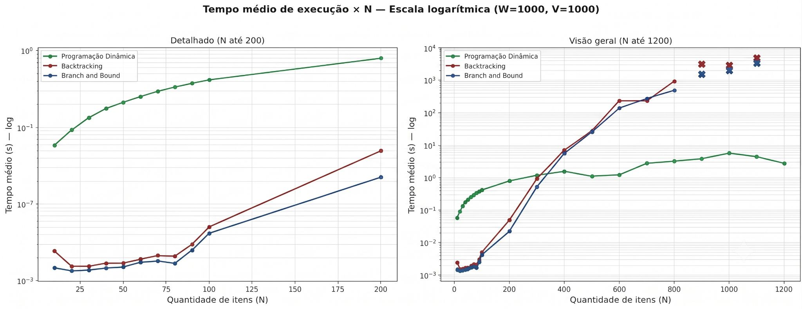
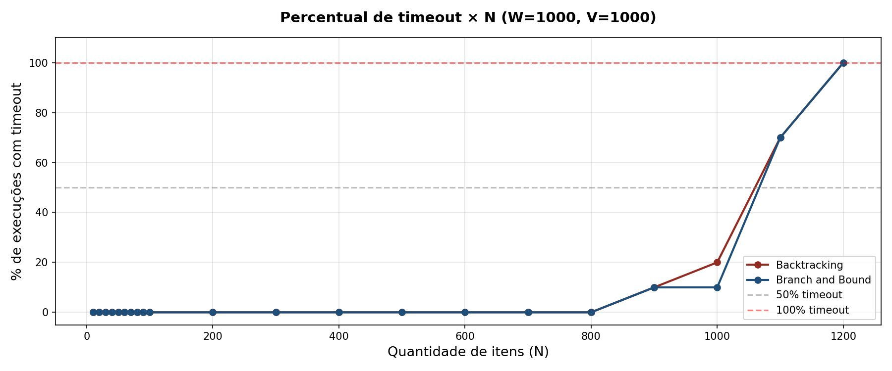
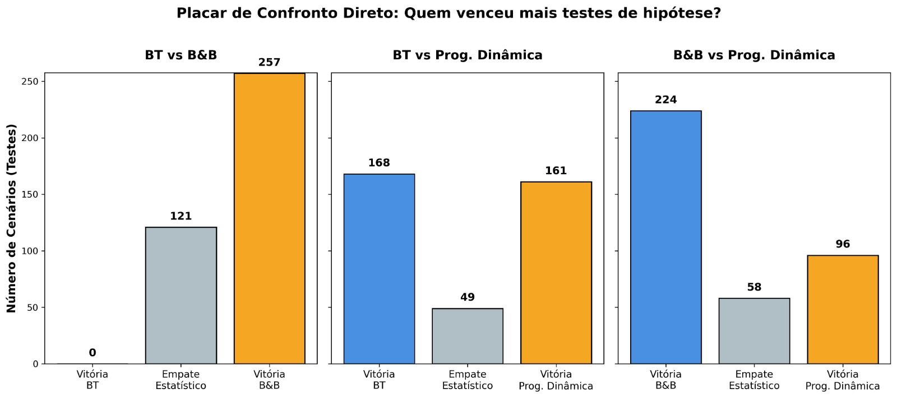

# Problema da Mochila 2D: Programação Dinâmica, Backtracking e Branch and Bound

Implementação em **C** e comparação experimental de três algoritmos exatos para o **problema da mochila 0/1 com duas restrições**: peso e volume. O trabalho foi feito em grupo na disciplina de Projeto e Análise de Algoritmos (DECOM/UFOP, 2026/1), por Matheus Rodrigues, [Luiz Miguel](https://github.com/luiz-miguelw), Alejandro Martins e Matheus Renato.

Dados `n` itens, cada um com peso, volume e valor, o objetivo é escolher o subconjunto de **maior valor** sem passar da capacidade de peso `W` nem da capacidade de volume `V`.

## Algoritmos

| Algoritmo | Ideia | Custo |
|---|---|---|
| **Programação Dinâmica** (`src/dynamic.c`) | Tabela 3D `dp[i][w][v]` construída de baixo para cima; a solução é reconstruída percorrendo a tabela de trás para frente | Tempo e memória `O(n · W · V)`, pseudo-polinomial |
| **Backtracking** (`src/backtracking.c`) | Árvore de decisão incluir/excluir para cada item, cortando os ramos que estouram o peso ou o volume | `O(2ⁿ)` no pior caso, memória `O(n)` |
| **Branch and Bound** (`src/bnb.c`) | Busca em profundidade com poda por limite superior: o bound é o **menor** entre a relaxação fracionária por peso e a relaxação fracionária por volume, o que o mantém admissível com as duas restrições. Começa com uma solução gulosa e guarda os itens escolhidos num bitset | `O(n · 2ⁿ)` no pior caso (o bound custa `O(n)` por nó), mas poda boa parte da árvore na prática |

Os três algoritmos param sozinhos depois de **2 horas** de execução e informam a melhor solução encontrada até ali.

## Metodologia experimental

- **Gerador de instâncias** (`input_files/instance_generator.c`): para cada combinação `(N, W, V)` são geradas **10 instâncias**. Cada item tem peso entre 1 e `W`, volume entre 1 e `V` e valor entre 1 e 1000. Uma semente opcional permite reproduzir as instâncias.
- **Execução automática** (`menu.py`): roda os três algoritmos em todas as instâncias de uma grade `N × W × V` e salva lucro, tempo e timeout num CSV.
- **Estatística** (`scripts/stats_menu.py`): tempo médio, desvio padrão e **intervalo de confiança de 95%** por algoritmo e combinação.
- **Testes de empate** (`scripts/tests_menu.py`): compara os algoritmos dois a dois nas mesmas instâncias com o **teste dos sinais** bilateral (α = 0,05).
- **Gráficos** (`scripts/plots_menu.py`): tempo em função de `N`, `W` e `V`, além de um mapa de calor para a programação dinâmica.

## Resultados

Os três algoritmos são exatos e encontram o mesmo lucro ótimo. A diferença está no tempo e na memória.

- **Branch and Bound nunca perdeu para o Backtracking.** Nos testes estatísticos pareados, o BnB foi mais rápido em 257 cenários e empatou em 121. O Backtracking não venceu nenhum.
- **A Programação Dinâmica depende das capacidades, não de `N`.** Com `W = V = 1000`, ela resolve até `N = 1200` em poucos segundos e nunca estoura o tempo limite. Por outro lado, o tempo e a memória crescem com `W × V`, e a tabela deixa de caber na RAM quando as capacidades ficam muito grandes.
- **Backtracking e BnB explodem com `N`.** São milésimos de segundo até `N ≈ 100`, passam de minutos a partir de `N = 600` e começam a estourar as 2 horas em `N = 900`. Em `N = 1200`, os dois estouram em 100% das instâncias.
- **Não existe um algoritmo melhor para todos os casos.** Com muitos itens e capacidades pequenas, a Programação Dinâmica é a melhor escolha. Com capacidades grandes, o Branch and Bound é a abordagem mais robusta.







## Como executar

Requisitos: `gcc`, `make` e Python 3 com `pandas`, `scipy` e `matplotlib`.

```bash
make          # compila o programa principal (app/exe)
make gen      # compila o gerador de instâncias

# gera 10 instâncias com N=100, W=1000, V=1000 (semente opcional no fim)
cd input_files && ./generator 100 1000 1000 42 && cd ..

# roda um algoritmo: dynamic | backtracking | bnb
./app/exe input_files/instancia_n100_W1000_V1000_i1.txt bnb
```

A saída mostra o lucro máximo, os itens escolhidos, o peso e o volume usados e o tempo de execução.

Para rodar os experimentos completos e gerar as tabelas e os gráficos, use o menu interativo:

```bash
python3 menu.py
```

O passo a passo de cada opção do menu e o formato dos arquivos estão em [`DOCUMENTACAO.md`](DOCUMENTACAO.md).

## Formato da instância

```text
W V
peso_1 volume_1 valor_1
...
peso_n volume_n valor_n
```

## Estrutura

```
main.c                  # lê a instância e chama o algoritmo escolhido
src/                    # dynamic.c, backtracking.c, bnb.c, leitura e estruturas
headers/                # declarações (.h)
input_files/            # gerador de instâncias
scripts/                # benchmarks, estatísticas, testes e gráficos (Python)
tst/                    # script de coleta automática de métricas
menu.py                 # menu interativo para compilar, gerar e rodar experimentos
DOCUMENTACAO.md         # documentação detalhada
docs/figuras/           # gráficos dos resultados
```

**Stack:** C · Make · Python · pandas · SciPy · Matplotlib
